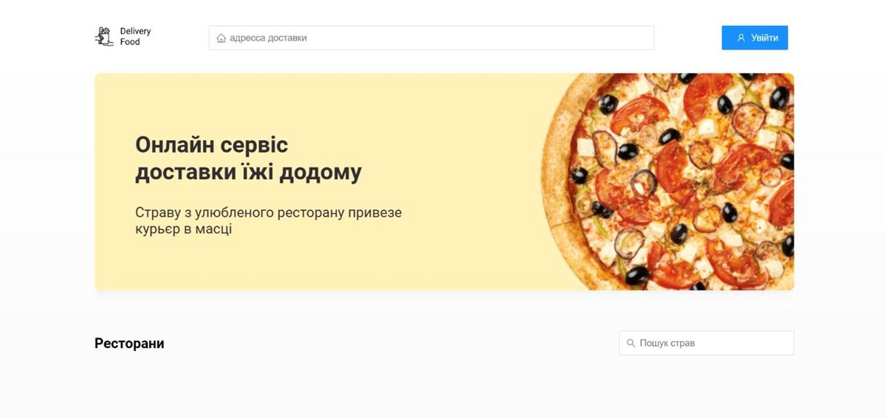

# Delivery Food — React App

Single-page food delivery app: restaurant list, restaurant menus, dish search, cart and sign-in modal. Data is stored in Firebase Realtime Database.

**Live demo:** https://chaika911.github.io/Food_delivery_site/



## Stack

- React 18 (functional components, custom hooks)
- React Router 6
- Redux + React Redux (cart state)
- Firebase Realtime Database
- SCSS
- React Slick (promo banner slider)

## Features

- Promo slider
- Restaurant cards loaded from Firebase
- Restaurant page with menu (`/restaurant/:products`)
- Dish search
- Cart modal with quantity control
- Sign-in modal rendered through a React Portal

## Run locally

```bash
npm install
npm start
```

## Deploy

```bash
npm run build
```

The `build` folder is published to the `gh-pages` branch. `404.html` is a copy of `index.html` so that routes work on GitHub Pages.

## Author

Vitalii Chaika — [portfolio](https://chaika911.github.io/myCV/) · [LinkedIn](https://www.linkedin.com/in/vitalii-chaika-dev/)
